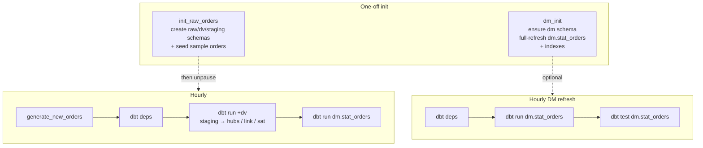
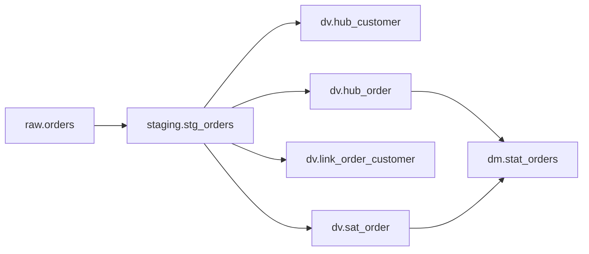

# Airflow + dbt Data Vault pipeline

A small end-to-end demo of **Apache Airflow** orchestrating **dbt** models that build a **Data Vault** (and a simple data mart) on Postgres from an online-store `raw.orders` stream.

## DAG graph



| DAG | Schedule | What it does |
| --- | --- | --- |
| `init_raw_orders` | manual | Creates `raw` / `dv` / `staging` schemas, `raw.orders`, seeds ~25 sample rows |
| `orders_to_dv` | hourly | Inserts a few new orders → `dbt deps` → Data Vault (`+dv`) → `dm.stat_orders` |
| `dm_init` | manual | Ensures `dm` schema, full-refresh of the mart, creates indexes |
| `dm_build` | hourly | Lightweight mart rebuild + dbt tests |



## Stack

- **Airflow 2.9** (LocalExecutor) + webserver / scheduler
- **Postgres** for Airflow metadata and a separate **DWH** database
- **dbt-postgres** models:
  - Data Vault: `hub_customer`, `hub_order`, `link_order_customer`, `sat_order`
  - Mart: `dm.stat_orders`

## Prerequisites

Docker Desktop installed and running.

## Start

```bash
docker compose up -d pg_airflow pg_dwh
docker compose up airflow-init
docker compose up -d airflow-webserver airflow-scheduler
```

Airflow UI: [http://localhost:8080](http://localhost:8080) — `admin` / `admin`

1. Unpause and run **`init_raw_orders`** once.
2. Optionally run **`dm_init`** once.
3. Unpause **`orders_to_dv`** (and optionally **`dm_build`**) for the hourly loop.

## Inspect the warehouse

```bash
docker exec -it $(docker ps -qf name=pg_dwh) psql -U dwh -d dwh
```

```sql
select * from raw.orders order by order_ts desc limit 10;
select * from dv.hub_customer limit 10;
select * from dv.hub_order limit 10;
select * from dv.link_order_customer limit 10;
select * from dv.sat_order order by load_ts desc limit 10;
select * from dm.stat_orders order by order_date desc limit 10;
```

## Notes

- dbt uses `DBT_PROFILES_DIR=/opt/airflow/dbt` and connects to the `pg_dwh` service.
- Hub / link models avoid duplicates via anti-joins; the satellite appends changes by `updated_at`.
- Clean slate: `docker compose down -v`.

## License

MIT — see [LICENSE](LICENSE).
